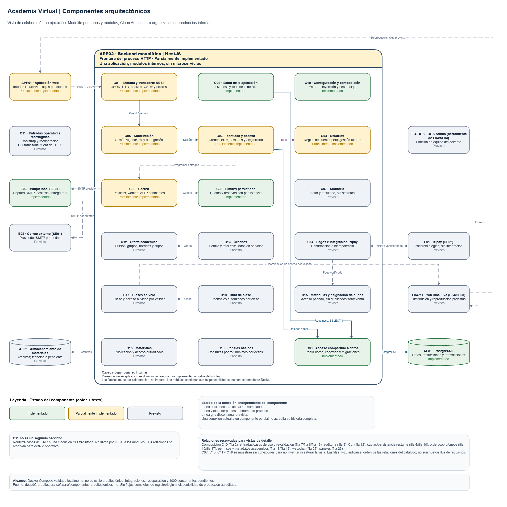

# Componentes arquitectónicos

## Organización y frontera

Academia Virtual adopta un **monolito por capas organizado internamente en módulos**, con **Clean Architecture** para las responsabilidades y dependencias del backend. Presentación adapta solicitudes; aplicación coordina casos de uso; dominio contiene reglas independientes de tecnología; infraestructura implementa contratos del núcleo. NestJS conecta las implementaciones mediante inyección de dependencias. Aplicación y dominio corresponden a la lógica de negocio de la vista de tres capas; los adaptadores de persistencia corresponden a datos, mientras que infraestructura también incluye correo, criptografía y pagos.

La frontera es **el servidor backend NestJS de APP02**: un proceso con C01–C10 y C12–C19, distinguiendo implementación y diseño previsto. C11 reutiliza código del backend en una ejecución CLI transitoria fuera de HTTP: bootstrap implementado, recuperación operativa pendiente. La web, los almacenes y los proveedores quedan fuera. Un componente puede agrupar funciones o adaptadores; no exige una clase, módulo Nest ni servicio independiente por fila.

React/Vite es la tecnología de APP01, PostgreSQL es AL01 y Docker Compose configura la ejecución local. No son módulos de negocio. Los servicios Compose `web`, `api`, `db` y `mailpit` son unidades de ejecución, no las capas ni los componentes internos. El entorno local está validado; los 1000 usuarios concurrentes siguen pendientes de pruebas de carga, con matrícula y clases diferenciadas.

## Diagrama de componentes

**Alcance temporal de la imagen:** conserva estados anteriores a T024; correo, auditoría, bootstrap y flujos de identidad deben actualizarse en el editable y reexportarse. El catálogo textual está contrastado hasta T058.

[Abrir el diagrama editable en Draw.io](../diagramas/componentes-arquitectonicos.drawio).

## Fuentes y estados

- [Actores](../01-analisis-de-sistema/01-actores.md), [historias HU](../01-analisis-de-sistema/02-historias-del-usuario.md) y [requisitos RF](../01-analisis-de-sistema/03-requisitos-funcionales.md) definen la síntesis del MVP. Las [restricciones](../01-analisis-de-sistema/05-restricciones.md) y el [alcance](../alcance-mvp.md) delimitan los módulos futuros.
- [Drivers DA](../01-analisis-de-sistema/06-driver-arquitectonicos.md), [decisiones](../01-analisis-de-sistema/07-decisiones-arquitectonicas.md) y [escenarios EQ](../01-analisis-de-sistema/08-escenarios-atributos-calidad.md) conservan sus identificadores. R01 define estructura; R02–R09, identidad e integraciones; R11/R12, entorno; D02, pagos; DEC01, video; D13, recuperación.
- [Arquitectura inicial](arquitectura-inicial.md), [estilo](estilo-arquitectonico.md), [enfoque](enfoque-arquitectonico.md) y [vista general](diagrama-arquitectura.md) describen el diseño. Para el estado actual se contrasta su contenido con código y evidencia posterior.
- [Especificación](../../specs/001-identidad-acceso-roles/spec.md), [plan](../../specs/001-identidad-acceso-roles/plan.md), [modelo de datos](../../specs/001-identidad-acceso-roles/data-model.md), [contrato API](../../specs/001-identidad-acceso-roles/contracts/api.md) y [contrato UI](../../specs/001-identidad-acceso-roles/contracts/ui.md) detallan identidad. US1–US7 y FR-001–FR-033 refinan una parte de HU01–HU07; no son otro catálogo de todo el MVP.
- Evidencias de fundamentos: [datos y reglas](../../specs/001-identidad-acceso-roles/evidence/reglas-credenciales-limites.md), [sesiones/HTTP](../../specs/001-identidad-acceso-roles/evidence/sesiones-autorizacion-http.md), [adaptadores de correo T024](../../specs/001-identidad-acceso-roles/evidence/adaptadores-correo.md), [ejecutor T025–T026](../../specs/001-identidad-acceso-roles/evidence/entregas-persistidas.md) y [auditoría T027](../../specs/001-identidad-acceso-roles/evidence/auditoria-privacidad.md). Checkpoints: [US1](../../specs/001-identidad-acceso-roles/evidence/us1.md), [US2](../../specs/001-identidad-acceso-roles/evidence/us2.md) y [US6, hasta T058](../../specs/001-identidad-acceso-roles/evidence/us6.md). Se citan ejecuciones registradas, sin repetir pruebas en esta revisión.

**Implementado** significa que la responsabilidad delimitada existe y tiene respaldo comprobado. **Parcialmente implementado** indica fundamentos o infraestructura comprobados con flujos pendientes. **Previsto** identifica responsabilidades aprobadas o propuestas por el alcance, sin componente operativo completo. Una fila implementada de infraestructura no completa sus HU/RF relacionados. Los contratos futuros no se presentan como interfaces ya disponibles.

APP01/APP02, C01–C19 y AL01/AL02 identifican elementos de esta vista, sin sustituir IDs de requisitos, actores o decisiones. Los sistemas externos conservan E01–E04 del catálogo de actores; E04 agrupa video y emisión. E04-YT y E04-OBS son referencias locales para distinguir sus dos participantes, sin renumerar el actor E04.

## Aplicaciones

| Identificador y nombre | Aplicación o contenedor | Responsabilidad | Interfaces ofrecidas o consumidas | Dependencias y propósito | Requisitos e historias | Drivers o escenarios | Estado y fuente |
| --- | --- | --- | --- | --- | --- | --- | --- |
| APP01 · Aplicación web | Workspace `apps/web/`; servicio Compose `web`; interfaz ejecutada en navegador | Presentar acceso, perfil y operaciones por rol; reproducir clases y ofrecer chat en el diseño previsto | Consume REST/JSON para acceso, registro, verificación y cambio inicial; video/chat previstos | APP02: operaciones US1/US2/US6 actuales; E04 y C18: reproducción/chat previstos | HU01–HU05, HU07–HU17; RF01–RF06, RF08, RF10–RF18; US1–US7 | DA01, DA03, DA09; EQ-01, EQ-06–EQ-08 | **Parcialmente implementada**: [App.tsx](../../apps/web/src/app/App.tsx) ensambla UI de US1/US2/US6 comprobada; administración, recuperación y funciones académicas pendientes |
| APP02 · Backend monolítico | Workspace `apps/api/`; servicio Compose `api` | Componer entradas, reglas y adaptadores dentro de una única aplicación | Ofrece salud y REST de US1/US2/US6; consume PostgreSQL y SMTP local. Chat y demás integraciones previstos | C01–C10: composición actual; C11: reutilización por CLI; C12–C19: módulos previstos. AL01: persistencia; E03: captura SMTP mediante C06 | RF01–RF19; HU01–HU17, con alcance detallado de identidad US1–US7 | DA01–DA10; EQ-01–EQ-11 | **Parcialmente implementado**: [AppModule](../../apps/api/src/app.module.ts) ensambla IdentityModule, UsersModule, autorización, salud, ejecutor de correo y registros privados. Checkpoints US1/US2/US6 comprobados; resto pendiente |

## Componentes internos existentes y fundamentos

Todos estos elementos pertenecen a APP02 y se ejecutan en el servicio `api`. Sus conexiones se explican en términos de responsabilidad; no implican servicios independientes.

| Identificador y nombre | Aplicación o contenedor | Responsabilidad | Interfaces ofrecidas o consumidas | Dependencias y propósito | Requisitos e historias | Drivers o escenarios | Estado y fuente |
| --- | --- | --- | --- | --- | --- | --- | --- |
| C01 · Entrada y transporte REST | APP02 / `api`; presentación | Adaptar JSON, DTO, cookies, origen/CSRF y errores; invocar casos de uso sin reglas de negocio ni SQL | `configureTransport`, `strictDto`, `SessionCookie`, filtro de errores; consume controles de C05 | C10: entorno; C05: autorización; C03: acceso/registro/verificación/inicial; C04: consulta propia | RF01–RF06, RF08, RF09; HU01–HU05, HU07; FR-018, FR-023, FR-026 | DA01, DA09; EQ-07, EQ-10 | **Parcialmente implementado**: transporte T023 y controladores REST de US1/US2/US6 conectados. Entradas administrativas y académicas pendientes |
| C02 · Salud de la aplicación | APP02 / `api`; presentación operativa | Distinguir proceso vivo de disponibilidad de BD/configuración; no depende de entrega SMTP | Ofrece `GET /health/live` y `GET /health/ready`; consume contrato `Readiness` | C09: `SELECT 1` para readiness; C01: respuesta segura. No consulta sesión ni renueva actividad | RF19; necesidad operativa A05, sin HU de producto nueva | DA08, DA10; EQ-04, EQ-11 | **Implementado** en su alcance: [HealthController](../../apps/api/src/http/health.controller.ts), composición real y T023. No acredita disponibilidad de producción |
| C03 · Identidad y acceso | APP02 / `api`; aplicación, dominio e infraestructura del módulo | Gestionar credenciales, sesiones, registro, verificación y sustitución inicial; recuperación y gestión administrativa previstas | IdentityModule y casos Login, Logout, RegisterStudent, IssueActionLink, RequestVerification, VerifyEmail, BootstrapAdmin y SetInitialPassword; contratos de credenciales/persistencia; SessionRepository de C05 | C04: reglas de cuenta; C08: cuotas; C09: sesiones/cuentas/tokens; C06: payload y entregas persistidas; C07: auditoría de bootstrap | RF01–RF04, RF07, RF08; HU01–HU03, HU06, HU07; US1, US2, US5–US7 | DA01, DA05, DA06; EQ-02, EQ-03, EQ-07, EQ-11 | **Parcialmente implementado**: [IdentityModule](../../apps/api/src/modules/identity/identity.module.ts) conectado; US1/US2/US6 comprobadas. US4, US7 y aceptación transversal pendientes |
| C04 · Usuarios | APP02 / `api`; núcleo del módulo | Validar cuenta y proyectar identidad propia; administración de usuarios prevista | users/public/account.ts y UserView; GET /me mediante GetMe y UserQueries | C03: reglas/proyección; C05: permiso profile:read; C09: consultas propias. Auditoría y persistencia administrativas previstas | RF05, RF06, RF08; HU04, HU05, HU07; US3–US5; FR-010–FR-020 | DA01, DA07, DA09; EQ-07, EQ-10 | **Parcialmente implementado**: [UsersModule](../../apps/api/src/modules/users/users.module.ts), [GetMe](../../apps/api/src/modules/users/application/get-me.ts) y PostgresUserQueries; /me comprobado en US1. US3 completo y administración pendientes |
| C05 · Autorización | APP02 / `api`; entrada, aplicación y dominio | Denegar por defecto, resolver sesión vigente y permiso; registrar actividad solo en respuesta protegida aceptada | Ofrece `SessionLookup`, matriz `permits`, guard/interceptor; consume `SessionRepository` y `SessionCookie` | C03: adaptador de sesiones inyectado, sin importar `IdentityModule`; C04: tipo de rol. Casos de uso futuros deben revalidar actor antes de confirmar mutaciones | RF03, RF08; HU02, HU07; US5; FR-018–FR-020 | DA01, DA09; EQ-07, EQ-08 | **Parcialmente implementado**: guard, interceptor y sesiones conectados a /me; rechazos y acceso actual comprobados en US1. US5 transversal, gestión administrativa y permisos académicos pendientes |
| C06 · Correo | APP02 / `api`; ejecutor interno y adaptadores | Procesar entregas persistidas, cifrar payload y reclamar/reintentar/cancelar fuera de HTTP | Mailer, PayloadCipher, DeliveryEligibility y DeliveryStore; DeliverPending.tick y DeliveryScheduler | C08: cuota SMTP; C09: claims/entregas; adaptador de C03: elegibilidad; E03: captura local actual. E02: proveedor de producción pendiente | RF02, RF04; HU01, HU03, HU05, HU06; FR-029–FR-033 | DA06, DA08; EQ-11 | **Parcialmente implementado**: [DeliverPending](../../apps/api/src/modules/mail/application/deliver-pending.ts), SMTP/cifrado y scheduler T024–T026 comprobados; correo funcional de US2/US6 capturado en Mailpit. Emisión de recuperación US7, purga integral T095 y producción pendientes |
| C07 · Auditoría | APP02 / `api`; dominio/adaptador de auditoría y registros comunes | Registrar cambios aceptados y contexto permitido de actor/resultado, sin secretos | auditEvent valida eventos; PostgresAuditWriter.write usa la transacción del cambio; SecurityEvents.record genera registros privados. Sin endpoint | C03/C11: bootstrap auditado y correlación operativa actuales; C04: cambios administrativos futuros; C09: persistencia en el mismo commit | RF09; HU05–HU07; FR-025, FR-026, FR-033 | DA01, DA08; EQ-07, EQ-10 | **Parcialmente implementado**: [audit-writer](../../apps/api/src/modules/audit/infrastructure/audit-writer.ts) y [SecurityEvents](../../apps/api/src/infrastructure/logging/security-events.ts), T027; bootstrap funcional US6. Auditoría administrativa y aceptación V12/V16 completas pendientes |
| C08 · Límites persistidos | APP02 / `api`; infraestructura común | Admitir/reservar intentos y cuotas equivalentes, mantener ventanas y concurrencia entre solicitudes | PostgresRateStore.reserveLogin, finishLogin y admitMail; contratos LoginLimits y ActionLinkLimits para consumidores de aplicación | Reglas de C03/C06: ventanas y fases; C04: normalización; C09: transacciones cortas y locks. No sostiene locks durante hash/SMTP | RF02–RF04; HU01–HU03; FR-022, FR-031 | DA01, DA05, DA06; EQ-03, EQ-11 | **Implementado en el alcance actual**: cuotas persistidas utilizadas por login/inicial, registro/reenvío, bootstrap y ejecutor SMTP. Recuperación funcional US7 y limpieza integral T095 pendientes |
| C09 · Acceso compartido a datos | APP02 / `api`; infraestructura común | Crear/cerrar pool compartido y cliente Prisma; proporcionar conexión sin reglas de negocio y soporte de migraciones | Ofrece `createDatabase`, `pool`, `prisma`, `close`; consume protocolo PostgreSQL | C10: configuración; AL01: conexión. Infraestructura de cada módulo usa estas capacidades para consultas y transacciones | RF01–RF09, RF19; HU01–HU07 como soporte, sin cumplimiento funcional completo | DA02, DA05, DA08, DA10; EQ-02, EQ-04, EQ-05, EQ-10 | **Implementado como infraestructura**: [database.ts](../../apps/api/src/infrastructure/database/database.ts), [schema](../../apps/api/prisma/schema.prisma) y T011–T016. Generación de cliente y deploy comprobados; `migrate:dev` con base sombra no validado |
| C10 · Configuración y composición | APP02 / `api`; infraestructura/arranque | Validar entorno y secretos, seleccionar recursos y ensamblar adaptadores sin acoplar el dominio | `loadEnvironment` y `AppModule.forRoot`; no interfaz pública HTTP | C09: pool; C01: transporte; C03/C04/C05: identidad, consulta propia y autorización; C06: ejecutor/cifrado/SMTP; C07: registros; C02: readiness | RF08, RF19; soporte de HU07 y operación A05 | DA07–DA10; EQ-04, EQ-07, EQ-10 | **Implementado para la composición actual**: [AppModule](../../apps/api/src/app.module.ts), entorno y main ensamblan US1/US2/US6 y correo interno; módulos futuros sin ensamblar |

Credenciales, sesiones, cuotas, entregas y auditoría tienen fundamentos comprobados; los checkpoints US1/US2/US6 ejercitan parte de esas capacidades. No completan C03–C07 ni el MVP entero. Las mutaciones administrativas futuras deben revalidar actor/invariantes dentro de su transacción; el guard no basta.

`ProbeModule`, presente en [probe.module.ts](../../apps/api/src/probe.module.ts), se conserva como esqueleto de ensayo V00. No está importado por el AppModule actual y no se cataloga como segundo componente de salud en ejecución. Las rutas protegidas de prueba tampoco forman parte de la API de producto.

## Entradas operativas y componentes previstos del MVP

Las interfaces académicas siguientes describen capacidades necesarias, no firmas, endpoints ni contratos ya aprobados. Sus reglas detalladas deben especificarse antes de implementar. No se proponen carpetas nuevas ni se presenta «administración» como otro módulo que duplique usuarios, cursos o matrículas.

| Identificador y nombre | Aplicación o contenedor | Responsabilidad | Interfaces ofrecidas o consumidas | Dependencias y propósito | Requisitos e historias | Drivers o escenarios | Estado y fuente |
| --- | --- | --- | --- | --- | --- | --- | --- |
| C11 · Entradas operativas restringidas | APP02; ejecución CLI transitoria con infraestructura del backend, fuera de HTTP | Bootstrap único y recuperación segura, invocando casos de uso sin registro privilegiado público | admin:bootstrap y BootstrapAdmin actuales; invalidación tras restaurar y recuperación operativa pendientes | C03/C04: inicializar y validar cuenta; C07: auditoría/log privado; C09: marca irreversible; C06: payload/entrega de verificación. Cancelar entregas restauradas sigue previsto | RF07, RF19; HU06, operación A05; US6; FR-027, FR-028 | DA01, DA08, DA10; EQ-04, EQ-10 | **Parcialmente implementado**: [bootstrap CLI](../../apps/api/src/cli/bootstrap-admin.ts) comprobado en US6; [operación](../../ops/local/first-admin.md). Invalidación y recuperación T096–T098 pendientes |
| C12 · Oferta académica | APP02 / `api`; módulo previsto | Consultar/gestionar cursos, grupos, horarios y cupos | Capacidades de oferta y gestión previstas; REST por definir | C05: permisos académicos futuros; C09: persistencia; C15: coordinación de cupos según D04/D06 | RF10; HU08, HU09 | DA01, DA02, DA05; EQ-05 | **Previsto**: alcance/RF10; horarios, reservas y matriz de permisos pendientes D04/D06/D12 |
| C13 · Órdenes | APP02 / `api`; módulo previsto | Seleccionar cursos y calcular conceptos/total en servidor, conservando detalle | Crear/consultar orden, capacidades internas de precio/detalle por definir | C12: oferta/precios; C05: actor autorizado; C09: persistencia; C14/C15: cobro y matrículas según políticas pendientes | RF11; HU10, HU11 | DA02, DA05; EQ-05, EQ-09 | **Previsto**: alcance/RF11, D01–D06. Un pago por orden sigue siendo propuesta |
| C14 · Pagos e integración Izipay | APP02 / `api`; módulo/adaptador previstos | Verificar autenticidad, orden, importe/moneda y procesar reintentos idempotentes | Contrato interno de pagos y recepción/verificación de notificaciones por definir; consume interfaz de Izipay | E01: iniciar/verificar cobro; C13: orden/total confiable; C15: habilitar matrículas tras confirmación; C09: transacción e idempotencia | RF12, RF13; HU11 | DA02, DA06; EQ-05, EQ-09 | **Previsto**: D02, R07 y RF12; sandbox, condiciones comerciales y reglas pendientes, sin integración |
| C15 · Matrículas y asignación de cupos | APP02 / `api`; módulo previsto | Activar acceso académico tras pago verificado, evitar duplicados y sobreventa | Capacidad interna de matrícula/autorización académica por especificar | C14: pago comprobado; C12: cupos; C13: cursos de orden; C09: atomicidad. Provee vigencia a C16–C18 y controles académicos futuros | RF13, RF14, RF16, RF17; HU11, HU12, HU15, HU16 | DA01, DA02, DA05; EQ-05, EQ-08, EQ-09 | **Previsto**: alcance, RF13 y D01–D06; estados, vigencia y reserva no definidos |
| C16 · Materiales | APP02 / `api`; módulo previsto | Publicar y permitir acceso a recursos académicos autorizados | Capacidades REST de publicación/acceso y contrato de almacenamiento por definir | C12: curso/grupo; C05/C15: permiso/matrícula; C09: metadatos; AL02: archivos | RF14, RF15; HU12, HU13 | DA01, DA07; EQ-08, EQ-10 | **Previsto**: alcance y RF14/RF15; formatos, límites, almacenamiento y publicación pendientes D12 |
| C17 · Clases en vivo | APP02 / `api`; módulo previsto | Coordinar clase y autorización de reproducción, conservando la elección de video | Capacidad de acceso/coordinación por definir; integración con proveedor no acreditada | C12: clase/grupo; C05/C15: permisos y vigencia; C09: metadatos; E04: distribución externa, sin asumir API de control disponible | RF16; HU14, HU15 | DA01, DA03, DA05; EQ-06, EQ-08 | **Previsto**: DEC01 y RF16; YouTube Live con OBS elegido, control de acceso y compatibilidad pendientes D07/D08 |
| C18 · Chat de clase | APP02 / `api`; gateway y módulo previstos | Mensajes/reconexión autorizados e aislamiento entre clases | Conexión en tiempo real; Socket.IO propuesto, eventos y contrato aún por definir | APP01: clientes; C17/C12: contexto de clase; C05/C15: autorización académica. Persistencia de mensajes no definida, sin conexión a AL01 asumida | RF17; HU16 | DA01, DA05; EQ-06, EQ-08 | **Previsto**: alcance/RF17; sin gateway ni prueba de carga de chat. No incluye audio/cámara/pantalla de alumnos |
| C19 · Paneles básicos | APP02 / `api`; capacidades de consulta previstas; UI en APP01 | Ofrecer datos/acciones académicos autorizados por rol | Consultas REST por definir; no métricas financieras/académicas aprobadas por defecto | C05: permisos; capacidades públicas de C12–C18: datos autorizados según D12, sin importar internos ni consultar sus tablas directamente | RF18; HU17 | DA01, DA07, DA09; EQ-10 | **Previsto**: alcance/RF18 y D12. Se distingue del inicio mínimo de identidad RF05/HU04 |

## Almacenes fuera de la frontera del backend

| Identificador y nombre | Aplicación o contenedor | Responsabilidad | Interfaces ofrecidas o consumidas | Dependencias y propósito | Requisitos e historias | Drivers o escenarios | Estado y fuente |
| --- | --- | --- | --- | --- | --- | --- | --- |
| AL01 · PostgreSQL | Servicio Compose `db`; almacén del sistema fuera de APP02 | Persistencia, restricciones, índices y transacciones. No ejecuta la orquestación de negocio ni llama a proveedores | Protocolo PostgreSQL consumido mediante pool/Prisma y adaptadores internos | C09 y adaptadores del backend: almacenar/consultar y confirmar cambios atómicos; volumen: conservación local | RF01–RF09, RF11–RF13, RF19 como soporte; HU01–HU07, HU10/HU11 previstas | DA02, DA05, DA08, DA10; EQ-02, EQ-04, EQ-05, EQ-09 | **Implementado como servicio local**: Docker y pruebas de migraciones. Ocho modelos de identidad y cuatro migraciones verificados en BD de prueba; eso no afirma migración funcional de desarrollo/producción ni tablas académicas existentes |
| AL02 · Almacenamiento de materiales | Ubicación y tecnología pendientes; fuera de APP02 en esta vista lógica | Conservar archivos publicados bajo reglas de acceso | Contrato de almacenamiento por definir | C16: escritura/lectura autorizadas; ubicación y controles pendientes D12 | RF14, RF15; HU12, HU13 | DA01, DA07; EQ-08, EQ-10 | **Previsto**: alcance y vista general; no proveedor ni almacén implementado. No se decide aquí un servicio o contenedor |

## Sistemas externos a la aplicación

E03 es un servicio local de apoyo y no un proveedor de producción. E04 contiene dos participantes distintos del flujo de video; ni OBS ni YouTube se ejecutan como módulos del backend.

| Identificador y nombre | Aplicación o contenedor | Responsabilidad | Interfaces ofrecidas o consumidas | Dependencias y propósito | Requisitos e historias | Drivers o escenarios | Estado y fuente |
| --- | --- | --- | --- | --- | --- | --- | --- |
| E01 · Izipay (SE02) | Proveedor externo | Procesar operaciones de pago y permitir comprobar su resultado | Interfaz de proveedor/notificaciones, contrato de integración pendiente | C14: solicitud/verificación de pago. No se conecta a AL01 | RF12, RF13; HU11 | DA02, DA06; EQ-09 | **Previsto en la integración**: elección D02 aceptada, sin integración ni sandbox probado |
| E02 · Correo externo (SE01) | Proveedor SMTP por definir | Entregar mensajes reales de verificación/recuperación | SMTP seguro según configuración/proveedor | C06: envío fuera de HTTP; sin acceso a AL01 | RF02, RF04; HU01, HU03, HU05, HU06 | DA06, DA08; EQ-11 | **Previsto**: R07/RT07; proveedor, TLS, remitente, DNS, cuota y costo pendientes |
| E03 · Mailpit local (SE01) | Servicio Compose `mailpit`; fuera de APP02 | Capturar correo de pruebas sin entrega externa | SMTP y consulta HTTP de mensajes | C06: captura SMTP funcional de US2/US6; consulta HTTP para comprobar mensajes. El estado de entregas pertenece a PostgreSQL | Soporte de RF02/RF04 y HU01/HU03, sin completarlos | DA06, DA10; EQ-11 | **Implementado como apoyo local**: captura de registro/verificación y bootstrap comprobada en US2/US6. No acredita proveedor ni entrega de producción |
| E04-YT · YouTube Live (E04/SE03) | Proveedor externo de video | Distribuir la transmisión y ofrecer reproducción | Emisión desde OBS y reproducción web; control de acceso compatible con RF16 por validar | APP01: reproducción; C17: coordinación prevista; E04-OBS: emisión. Sin relación con AL01 | RF16; HU14, HU15 | DA03, DA05; EQ-06, EQ-08 | **Previsto en la integración**: DEC01 aceptada; emisión/reproducción y protección no acreditadas |
| E04-OBS · OBS Studio (herramienta de E04/SE03) | Equipo del docente, fuera de APP02 | Capturar y emitir audio/video del docente | Consume destino de transmisión de YouTube Live | Docente A03: operación de emisión; E04-YT: distribución. No se presupone control remoto por C17 | RF16; HU14 | DA03; EQ-06 | **Previsto**: DEC01/RT08; sin ensayo reproducible registrado |

## Relaciones para el futuro diagrama del backend

Las relaciones siguientes expresan colaboración en ejecución. **Actual** significa conectada por la composición de producto; **fundamento probado** significa que la interacción existe pero no acredita un flujo de negocio; **prevista** significa que aún requiere implementación o contrato. La dirección de una llamada no sustituye la regla de dependencias del código.

| Origen y destino | Propósito de la conexión | Interfaz o mecanismo | Estado y límite |
| --- | --- | --- | --- |
| APP01 → C01 | Solicitar operaciones del backend | REST/JSON, mismo origen y cookies según R03 | Actual en US1/US2/US6; administración, recuperación y academia previstas |
| C10 → C09, C01, C05, C02 | Ensamblar recursos y transporte; además conecta identidad/usuarios, correo interno y registros privados | Configuración e inyección Nest | Actual; se representa como composición si aporta claridad, no como flujo de alumno |
| C01 → C05 → C03 | Resolver cookie, sesión y permiso antes de una entrada protegida | Guard → SessionLookup → SessionRepository, implementado por PostgresSessionStore | Actual para sesión/permiso en /me; rutas públicas no exigen sesión. No implica que cada solicitud siga ese recorrido |
| C02 → C09 → AL01 | Comprobar disponibilidad de BD | Readiness y `SELECT 1` por pool | Actual; liveness no consulta BD y ninguno renueva sesión |
| C03 → C04 | Aplicar validación y tipos de cuenta | Superficie pública de usuarios | Actual en validación/proyección de los flujos implementados, mediante superficie pública |
| C03 y C08 → C09 → AL01 | Persistir cuentas/sesiones/tokens y cuotas con transacciones | Pool compartido y SQL parametrizado; adaptadores por responsabilidad | Actual en US1/US2/US6; recuperación y mutaciones administrativas pendientes |
| C01 → C03/C04 | Invocar casos de uso de identidad/perfil/administración | Contratos de aplicación y contrato REST | Actual para US1/US2/US6 y /me; administración prevista |
| C03/C04 → C05 y persistencia de C03 | Validar actor y revalidar dentro de cambios de acceso | Contratos públicos y coordinación transaccional del plan | Prevista en mutaciones; helper de revalidación ya probado, sin introducir pg en aplicación |
| C03/C04/C11 → C07 | Registrar cambios aceptados o evento operativo | Contrato interno de auditoría | Actual en bootstrap y registros privados; escritura atómica de auditoría administrativa pendiente |
| C03 → C06 → C08/C09 | Programar entregas con token y cuotas persistidas | Productores de identidad registran token/entrega atómicos; cifrado por contrato y procesamiento interno posterior | Actual en verificación US2/US6; SMTP fuera de HTTP y de locks prolongados. Recuperación de contraseña pendiente |
| C06 → E03 o E02 | Capturar localmente o enviar correo real | Adaptador SMTP por entorno | Actual C06 → E03, con Mailpit y ejecutor funcional; C06 → E02 de producción prevista |
| C11 → C03/C04/C06/C07/C09 | Bootstrap y recuperación con invalidación segura | Entradas restringidas y casos de uso internos | Bootstrap actual; invalidación tras restauración/recuperación pendientes. Sin endpoint privilegiado ni otro servidor |
| C01 → C12–C17/C19 | Adaptar operaciones académicas futuras | REST hacia capacidades de aplicación | Prevista; rutas y permisos concretos por especificar |
| C13 → C12 | Consultar oferta y precios confiables | Contrato interno por definir | Prevista; cálculo de total en servidor |
| C14 ↔ C13; C14 → E01 | Relacionar cobro con orden e iniciar/verificar pago | Capacidades de orden y adaptador Izipay | Prevista; sentido de iniciación exacto sujeto a D01/D02, sin duplicar dos orquestadores |
| E01 → C14 → C15 | Recibir confirmación auténtica y producir matrículas | Entrada de notificación/adaptador y coordinación transaccional | Prevista; una respuesta del navegador no autoriza matrícula |
| C15 ↔ C12/C13; C15 → C09 | Coordinar cursos/cupos/orden y persistir consistencia | Contratos internos y transacciones | Prevista; atomicidad, reservas y pago tardío pendientes D01–D06 |
| C16/C17/C18 → C05/C15/C12 | Resolver actor, autorización académica y contexto | Capacidades públicas futuras de permiso, vigencia y curso/grupo | Prevista; la matriz de identidad actual no autoriza recursos académicos |
| C16 → AL02; C16 → C09 | Acceder a archivos y persistir sus metadatos | Adaptadores de archivos y datos | Prevista; tecnología y límites por definir |
| Docente A03 → OBS → YouTube Live → APP01 | Emitir y reproducir el video | Transmisión y reproductor del proveedor | Prevista; recorrido externo a APP02, sin transportar medios por PostgreSQL |
| C17 → E04 (YouTube Live) | Coordinar el acceso previsto a la clase | Integración y compatibilidad por validar | Prevista; no se afirma una API capaz de proteger manifiestos/segmentos |
| APP01 ↔ C18; C18 → C17/C12 | Participar en chat y situar mensajes en su clase | Gateway/contrato de tiempo real por definir; Socket.IO propuesto | Prevista; autorización y aislamiento requeridos, almacenamiento de mensajes sin definir |
| C19 → capacidades públicas de C12–C18 | Obtener datos/acciones autorizados para paneles | Consultas internas por definir | Prevista y limitada por D12; no acceso a tablas o internos de módulos ajenos |

En el futuro diagrama deben distinguirse las relaciones actuales de las previstas, agrupar C01–C10 y C12–C19 dentro del servidor APP02 y situar APP01, AL01/AL02 y E01–E04 fuera. C11 se identifica como entrada operativa fuera del proceso HTTP: sus llamadas significan reutilización de casos de uso en la CLI, no solicitudes de red al servidor. Los proveedores se conectan a C14, C06 y C17 según su función; no desde PostgreSQL. El flujo externo de medios debe mantenerse separado de la coordinación de clases y del chat. No se exige dibujar cada helper o repetir un almacén por módulo.

Para las dependencias del código se conserva presentación → aplicación → dominio e infraestructura → contratos internos. La composición importa las implementaciones necesarias; el dominio no importa NestJS, Prisma, HTTP, pg ni SMTP. La colaboración futura entre módulos debe exponerse mediante capacidades públicas pequeñas, sin ciclos ni llamadas HTTP internas. Las interfaces académicas y sus límites transaccionales requieren especificación; este catálogo no las aprueba por anticipado.

## Alcance de la evidencia y pendientes

Estado contrastado hasta **T058**: fundamentos de correo, auditoría y bootstrap implementados; checkpoints US1, US2 y US6 comprobados. C03/C04/C06/C07/C11 permanecen parciales por administración, recuperación, purga o aceptación transversal pendientes. No se ejecutan nuevas pruebas de comportamiento para esta sincronización documental.

Los módulos C12–C19 pertenecen al MVP respaldado por HU08–HU17 y RF10–RF18, pero aún requieren especificación funcional. D01–D06 delimitan órdenes/cupos/pagos; D07/D08, video y acceso; D12, materiales/paneles; D13, recuperación. Izipay, SMTP de producción y YouTube Live no tienen integración funcional acreditada. Los escenarios EQ y [verification.md](../../specs/001-identidad-acceso-roles/verification.md) definen verificaciones pendientes; los resultados locales no demuestran disponibilidad pública ni 1000 concurrentes.
