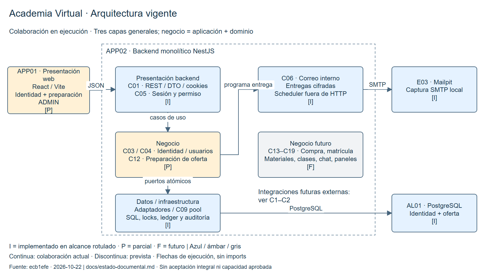

# Diagrama general de arquitectura vigente

Vista de colaboración en ejecución sobre el [corte revisado](../estado-documental.md).
Se distinguen aplicaciones, capas y módulos conforme al [estilo](estilo-arquitectonico.md).

[Draw.io editable](../diagramas/arquitectura-general.drawio) ·
[SVG](../diagramas/imagenes/arquitectura-general.svg).

APP01 presenta identidad y preparación de oferta ADMIN. APP02 adapta REST, ejecuta
casos de uso y reglas y usa adaptadores para AL01 y correo. El negocio reúne aplicación
y dominio; infraestructura implementa persistencia e integraciones. Las franjas del
diagrama son responsabilidades lógicas dentro de APP02, no servicios Docker.
El ejecutor de correo comparte proceso con la API; SMTP queda fuera de la solicitud.

Las flechas indican llamadas/servicios de ejecución, no imports. Para la inversión de
dependencias ver [Clean Architecture](enfoque-arquitectonico.md). Los destinos futuros
se agrupan para mantener legibilidad; su detalle está en el [catálogo](componentes-arquitectonicos.md)
y C3. No se dibuja PostgreSQL llamando proveedores ni un control backend–YouTube.

Convención común: **I** implementado en el alcance rotulado (azul); **P** parcial
(ámbar); **F** futuro, sin función disponible (gris). Línea continua: colaboración
actual; discontinua: prevista. La verificación se atribuye solo a la evidencia del
[inventario](../estado-documental.md). Ninguna vista acredita capacidad o producción.
La [vista inicial de 2026-10-06](arquitectura-inicial.md) se conserva como histórica.
