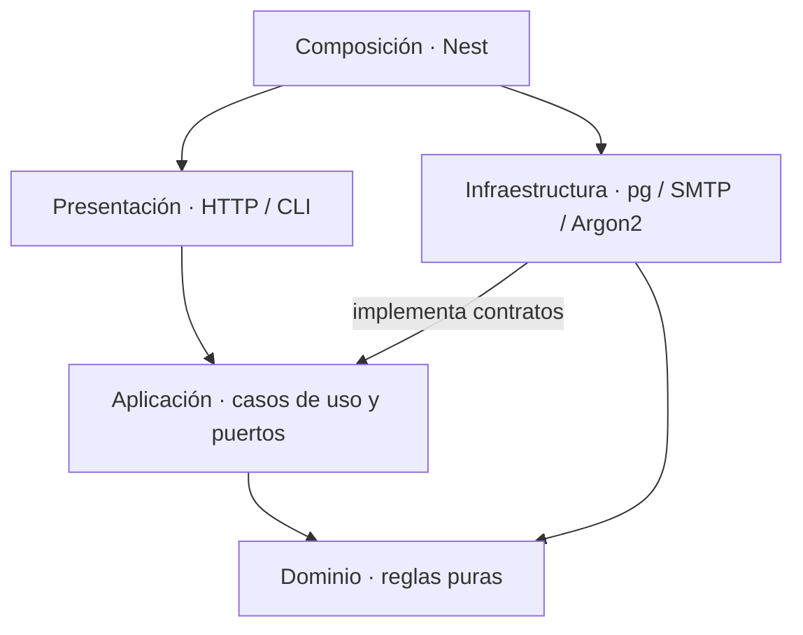

# Clean Architecture y dirección de dependencias

Clean Architecture orienta las dependencias internas del
[monolito modular](estilo-arquitectonico.md), según R01, DA07 y AC06. Las capas no son
aplicaciones ni servicios Docker. El [estado](../estado-documental.md) distingue ejemplos
existentes y destinos pendientes; no se exige una clase ni una carpeta vacía por capa.

| Responsabilidad | Código concreto | Dependencias permitidas |
| --- | --- | --- |
| Presentación | React y entradas REST/CLI; `AcademicAdminController`, DTO, cookies, errores | HTTP adapta y llama aplicación; la web consume JSON, no entidades Prisma |
| Aplicación | `PreparationCommands`, `AdministrativeQueries`, `Login`, `DeliverPending`; contratos | Dominio y superficies públicas puras; sin Request/Response, Nest, pg, SMTP o variables de entorno |
| Dominio | `course.ts`, `group.ts`, `schedule.ts`, reglas de acceso y permisos | Tipos/datos recibidos; sin IO; reglas de fecha civil no dependen de zona del host |
| Infraestructura | `createPreparationStore`, SQL/proyecciones, transacciones, Argon2, SMTP | Implementa contratos del núcleo, conoce bibliotecas y recursos externos |
| Composición | `AppModule.forRoot`, módulos Nest, main | Conoce e inyecta implementaciones; esa excepción no se traslada al núcleo |

**Las flechas anteriores son dependencias de código**. En ejecución, aplicación puede
llamar al objeto de infraestructura inyectado a través de su contrato. Ese recorrido
no implica importar infraestructura desde aplicación. En las tres capas generales,
aplicación + dominio forman negocio y los adaptadores de persistencia corresponden a
datos; infraestructura incluye además correo/criptografía.

Entre módulos se consumen superficies `public/`. Oferta consume tipos de sesión/permisos
de autorización y el directorio mínimo de usuarios; no importa implementaciones de
identidad. La composición inyecta `PostgresSessionStore.revalidateInTransaction` como
capacidad de infraestructura y un único pool. `SessionRepository` conserva lookup,
accept y revoke; no recibe PoolClient en su contrato público.

La vista SQL pública `AcademicTeacherDirectory`, propiedad de usuarios, expone
userId/name/eligible/eligibilityVersion a los adaptadores académicos. Permite JOIN bajo
una instantánea sin consultar campos privados de User. Los locks físicos de cuentas
pertenecen a infraestructura compartida; no son otra API de negocio ni HTTP interno.
Identidad no llama a oferta al cambiar una cuenta: el trigger incrementa generación;
la futura visibilidad comparará capturas. No hay callbacks identidad → oferta.

Los límites se comprueban en [regla de lint](../../ops/lint/import-boundaries.mjs) y
[pruebas de arquitectura](../../apps/api/tests/architecture/layers.spec.ts), ampliadas
en 002 T017 y repetidas en T028/T029. Esto acredita restricciones examinadas, no una
certificación universal de Clean Architecture. Ver el
[diseño concreto](../03-diseno-de-software/diseno-interno/diseno-interno-de-modulos.md)
y [contrato de integración](../../specs/002-oferta-academica/contracts/integration.md).
