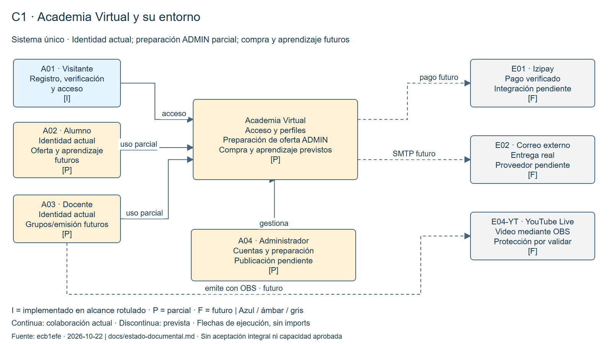
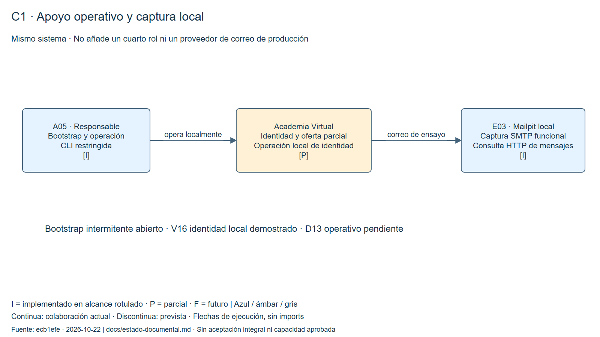

# C1 · Contexto de Academia Virtual

Un sistema para acceso, oferta y futura compra/aprendizaje. Amplía personas y entorno,
sin detalles internos. [Estado/versionado](../estado-documental.md) y
[leyenda/exportación](../diagramas/README.md) son comunes a los cuatro niveles.

[Editable, dos páginas](../diagramas/c4-contexto-del-sistema.drawio).

| ID | Persona / sistema | Relación y estado |
| --- | --- | --- |
| A01 / ACT01 | Visitante | Registro solo Alumno, verificación y acceso implementados; sin consulta pública de oferta |
| A02 / ACT02 | Alumno | Identidad/perfil implementados. Oferta publicada y aprendizaje previstos; sin audio/cámara/pantalla |
| A03 / ACT03 | Docente | Identidad/perfil implementados; lectura de asignados y materiales/emisión pendientes |
| A04 / ACT04 | Administrador | Cuentas y preparación de oferta implementadas; publicación/ciclo pendientes |
| A05 | Responsable del entorno | CLI y recuperación local; no cuarto rol ni registro público privilegiado |
| E01 / SE02 | Izipay | Elegida, integración pendiente; éxito del navegador no confirma pago |
| E02 / SE01 | Correo externo | SMTP real pendiente de proveedor/configuración/entrega verificada |
| E03 / SE01 | Mailpit | Captura funcional local de identidad; no proveedor de producción |
| E04-YT / E04 / SE03 | YouTube Live | Elección DEC01; emisión mediante OBS E04-OBS y reproducción previstas, protección por validar |

Las relaciones continuas solo acreditan el alcance rotulado; la relación persona–sistema
es parcial cuando combina identidad actual con academia futura. C1 no convierte proveedores
en módulos propios. AL01 es persistencia interna y aparece desde C2.
Fuentes: [actores](../01-analisis-de-sistema/01-actores.md),
[decisiones](../01-analisis-de-sistema/07-decisiones-arquitectonicas.md) y
[pendientes](../decisiones-pendientes.md). Bootstrap, aceptación humana, D10/D13 e
integraciones pendientes permanecen abiertos.
