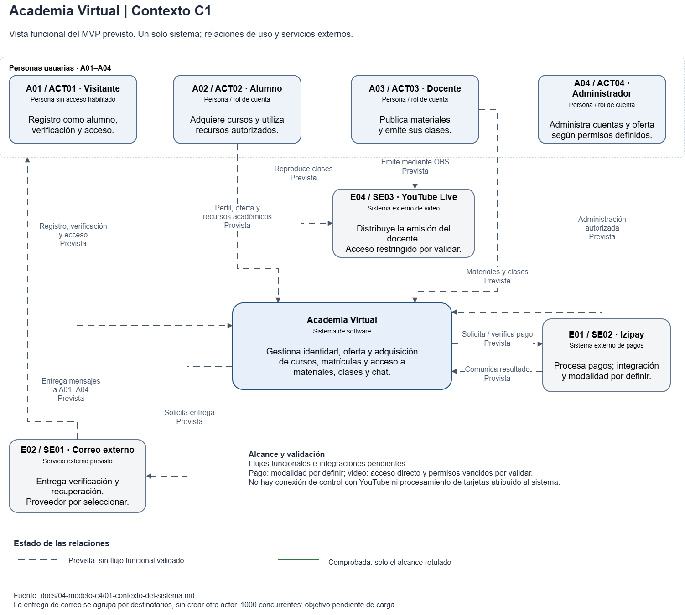

# Contexto del sistema

## Propósito y alcance

Academia Virtual es un único sistema para gestionar acceso y perfiles, ofrecer cursos, grupos, horarios y cupos, coordinar órdenes, pagos verificados y matrículas, y facilitar materiales, clases, chat y paneles autorizados. Estas capacidades describen el MVP previsto. El alcance excluye participación audiovisual del alumno, grabaciones automáticas, garantías contra copia, exámenes, certificados y aplicaciones móviles nativas; la consulta pública de cursos no está aprobada.

## Diagrama de contexto C1

[Editar el diagrama en Draw.io](../diagramas/c4-contexto-del-sistema.drawio)

El editable distingue contexto funcional y apoyo operativo/local. Docente → YouTube significa «Emite mediante OBS»; Alumno → YouTube, «Reproduce clases». Son acciones de uso, sin conexión de control del sistema con YouTube ni control remoto de OBS. La entrega de correo agrupa a A01–A04; el chat de clase pertenece a Academia Virtual, no se presupone el de YouTube.

## Personas

Las responsabilidades son previstas. Alumno, docente y administrador comparten acceso, verificación, recuperación y perfil; Visitante y Responsable del entorno no son roles adicionales.

| Identificador | Nombre | Responsabilidad |
| --- | --- | --- |
| A01 / ACT01 | Visitante | Registrarse solo como alumno, verificar correo y solicitar acceso o recuperación. |
| A02 / ACT02 | Alumno | Consultar oferta, adquirir cursos y utilizar materiales, clases y chat autorizados; participa solo por chat. |
| A03 / ACT03 | Docente | Consultar sus cursos, publicar materiales y emitir clases mediante OBS; no administra cuentas ajenas. |
| A04 / ACT04 | Administrador | Gestionar cuentas con un rol, auditoría y revocación; proteger al último administrador y administrar oferta según permisos definidos. |
| A05 | Responsable del entorno | Inicializar una vez el primer administrador y realizar conservación y recuperación restringidas. |

## Sistemas externos

| Identificador | Nombre | Propósito |
| --- | --- | --- |
| E01 / SE02 | Izipay | Procesar pagos y proporcionar resultados que el sistema compruebe antes de habilitar matrículas. |
| E02 / SE01 | Correo externo | Entregar verificación y recuperación; proveedor de producción por seleccionar. |
| E04 / SE03; E04-YT | YouTube Live | Recibir emisión del docente y distribuir video. OBS Studio (E04-OBS) es su herramienta de emisión. |
| E03 / SE01 | Mailpit local | Capturar mensajes de ensayo sin entrega real; apoyo local, no proveedor de producción. |

## Estado y decisiones pendientes

- Fundamentos de identidad comprobados; historias funcionales, operaciones académicas e integraciones externas pendientes. La captura técnica con Mailpit no acredita correos funcionales.
- **Pagos (D01–D06):** definir modalidad de integración, cupos, vigencia, cancelaciones y reembolsos; confirmar condiciones, pruebas y Yape (D02). No se atribuye procesamiento de tarjetas ni conexión técnica directa alumno–Izipay. La pantalla de éxito no confirma el pago.
- **Correo (R07/R08):** seleccionar proveedor, remitente, seguridad, cuotas y costo; comprobar entrega real.
- **Video (DEC01, D07/D08):** YouTube Live con OBS está elegido; integración y compatibilidad con RF16 pendientes. Validar acceso directo y permisos vencidos: autenticar una página u ocultar enlaces no demuestra restricción.
- **Permisos y operación:** asignación, publicación, moderación y paneles requieren especificación (D12); no se conceden facultades indefinidas. Recuperación, alojamiento y criterios de carga siguen abiertos (D09/D10/D13); 1000 concurrentes no están demostrados, distinguiendo matrícula y clases.

## Referencias esenciales

- [Actores](../01-analisis-de-sistema/01-actores.md) y [alcance del MVP](../alcance-mvp.md).
- [Requisitos funcionales](../01-analisis-de-sistema/03-requisitos-funcionales.md).
- [Decisiones arquitectónicas](../01-analisis-de-sistema/07-decisiones-arquitectonicas.md) y [pendientes](../decisiones-pendientes.md).
- [Arquitectura](../02-arquitectura-software/arquitectura-inicial.md) y [catálogo de componentes](../02-arquitectura-software/componentes-arquitectonicos.md).
- [Especificación de identidad](../../specs/001-identidad-acceso-roles/spec.md) y [plan](../../specs/001-identidad-acceso-roles/plan.md): contratos, tareas y evidencia detallada.
