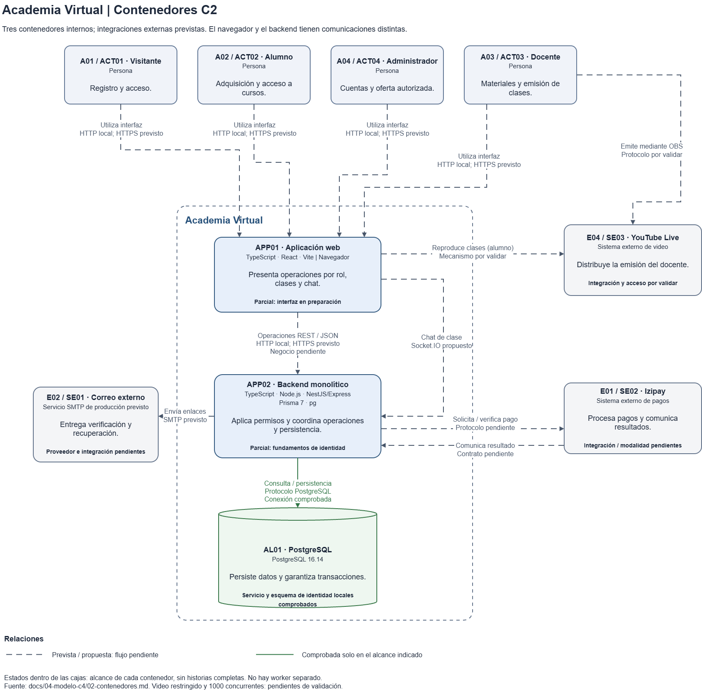

# Contenedores C2

## Descripción

Academia Virtual comprende una aplicación web, un backend monolítico por capas organizado en módulos con Clean Architecture y un almacén de datos. Se conservan los identificadores del catálogo. Un contenedor C4 es una aplicación o almacén de datos, no necesariamente un contenedor Docker. Esta vista amplía [C1](01-contexto-del-sistema.md) y distingue fundamentos comprobados de funcionalidades previstas.

## Diagrama de contenedores C2

[Editar el diagrama en Draw.io](../diagramas/c4-contenedores.drawio)

## Contenedores

| ID | Nombre | Responsabilidad | Tecnología | Estado |
| --- | --- | --- | --- | --- |
| APP01 | Aplicación web | Presentar acceso y operaciones por rol; reproducir clases y ofrecer chat | TypeScript, React, Vite; ejecución en navegador | Parcial: muestra «En preparación»; flujos y llamadas de negocio pendientes |
| APP02 | Backend monolítico | Aplicar permisos y reglas, coordinar operaciones y acceder a persistencia e integraciones | TypeScript, Node.js, NestJS/Express; Prisma 7 y pg | Parcial: salud, controles HTTP y fundamentos de identidad comprobados; historias y módulos académicos pendientes |
| AL01 | PostgreSQL | Persistir datos y garantizar restricciones y transacciones | PostgreSQL 16.14 | Servicio local y esquema de identidad comprobados; datos académicos y recuperación funcional pendientes |

Los módulos y comandos CLI no son contenedores adicionales. El ejecutor de correo de R08 será interno al proceso APP02 y sigue previsto, sin worker separado. AL02, almacenamiento de materiales, aún no tiene tecnología ni unidad de ejecución definida.

Izipay E01, Correo externo E02 y YouTube Live E04 pertenecen al entorno externo de C1. Mailpit E03 es apoyo local validado para captura técnica; no proveedor de producción ni flujo funcional de correo completo.

## Relaciones

| Origen | Destino | Propósito / protocolo |
| --- | --- | --- |
| A01–A04 | APP01 | Utilizar la interfaz en navegador; HTTP local, HTTPS previsto |
| APP01 (navegador) | APP02 | REST/JSON de negocio pendiente; proxy local `/api` configurado en Vite. Chat Socket.IO propuesto, sin contrato implementado |
| APP02 | AL01 | Consultar/persistir mediante protocolo PostgreSQL y pool compartido; conexión comprobada |
| APP02 | E01 · Izipay | Solicitar/verificar pagos; integración y protocolo exacto pendientes |
| E01 · Izipay | APP02 | Comunicar resultado comprobable; contrato de confirmación pendiente |
| APP02 | E02 · Correo externo | Entregar verificación/recuperación mediante SMTP seguro previsto; proveedor pendiente |
| APP02 | E03 · Mailpit local | SMTP de ensayo: captura técnica comprobada en pruebas, envío funcional pendiente |
| APP01 (navegador del alumno) | E04 · YouTube Live | Reproducir clases; integración y mecanismo por validar |
| A03 · Docente mediante OBS | E04 · YouTube Live | Emitir clases; protocolo y ensayo pendientes de validar |

La API local usa HTTP; R03 prevé HTTPS bajo un mismo origen para publicación. La reproducción ocurre en el navegador, sin conexión de control APP02–YouTube. PostgreSQL no llama a proveedores.

## Decisiones pendientes

- **Pagos (D01–D06):** modalidad, confirmación, cupos y vigencia; no se atribuye procesamiento de tarjetas ni conexión directa navegador–Izipay.
- **Correo (R07/R08):** proveedor, seguridad, costo y ejecutor funcional.
- **Video (DEC01, D07/D08):** acceso directo y permisos vencidos según RF16; una página autenticada no demuestra restricción.
- **Operación (D09/D10/D12/D13):** publicación/HTTPS, materiales, recuperación y carga; 1000 concurrentes siguen sin demostrar.

## Referencias esenciales

- [Catálogo de componentes](../02-arquitectura-software/componentes-arquitectonicos.md) y [estilo arquitectónico](../02-arquitectura-software/estilo-arquitectonico.md).
- [Decisiones arquitectónicas](../01-analisis-de-sistema/07-decisiones-arquitectonicas.md) y [pendientes](../decisiones-pendientes.md).
- [Plan de identidad](../../specs/001-identidad-acceso-roles/plan.md): contratos y ejecutor interno.
- [Aplicación web](../../apps/web/package.json), [backend](../../apps/api/package.json), [proxy local](../../apps/web/vite.config.ts) y [configuración local](../../compose.yml).
