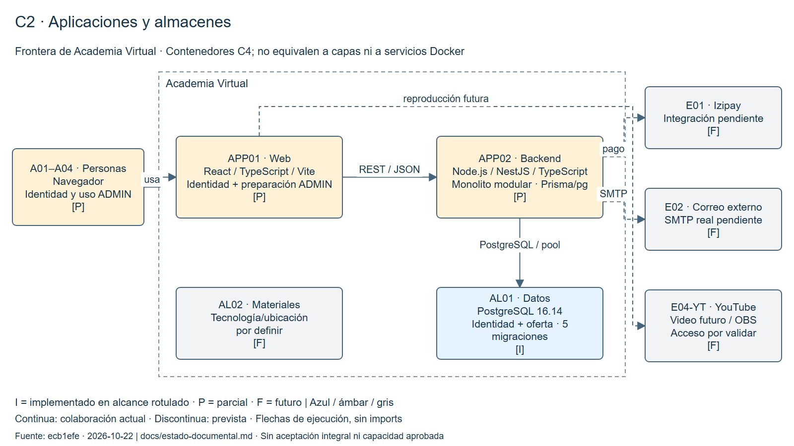
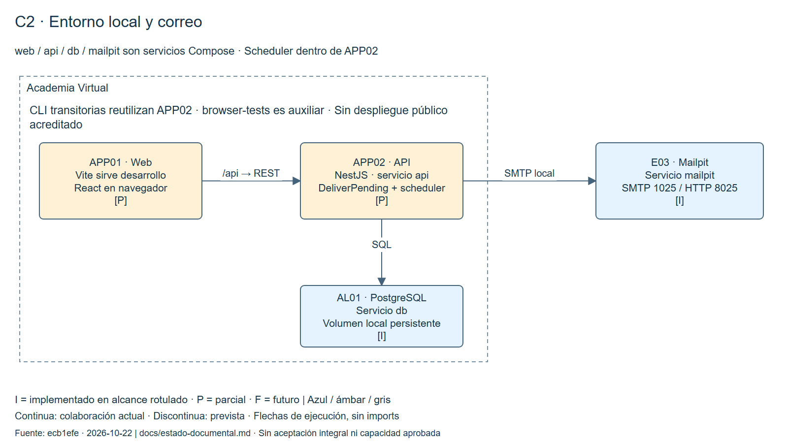

# C2 · Aplicaciones y almacenes

Amplía el sistema de [C1](01-contexto-del-sistema.md). Un contenedor C4 representa
aplicación/almacén; un servicio Docker representa empaquetado de ejecución local.
Las capas y módulos no son contenedores C4 adicionales.

[Editable, dos páginas](../diagramas/c4-contenedores.drawio) ·
[leyenda](../diagramas/README.md) · [estado/evidencia](../estado-documental.md).

| ID | Tecnología | Responsabilidad/estado |
| --- | --- | --- |
| APP01 | React, TypeScript, Vite | UI de identidad y preparación ADMIN implementadas; academia restante futura |
| APP02 | Node.js, NestJS/Express, TypeScript; Prisma y pg | Único backend modular; identidad, correo interno y preparación ADMIN; demás capacidades futuras |
| AL01 | PostgreSQL 16.14 | Persistencia con cinco migraciones de identidad/oferta; no demuestra datos manuales migrados ni producción |
| AL02 | Por definir | Archivos de materiales previstos; no unidad de ejecución contratada |

A01–A04 usan APP01 en navegador. APP01 → APP02 usa REST/JSON con cookie bajo `/api/v1`;
Vite proxy local sirve `/api`; publicación HTTPS/mismo origen pendiente. APP02 → AL01
usa protocolo PostgreSQL, un pool compartido y adaptadores; Prisma modela/genera,
pg ejecuta SQL/transacciones explícitas. APP02 → E03 usa SMTP local funcional;
E02 real sigue futuro. E03 expone HTTP al operador para revisar capturas.

E01 y E04 permanecen externos. La web reproduciría YouTube y OBS emitiría hacia él,
sin conexión backend de control acreditada. Contrato/modalidad de pagos pendientes;
no se presupone conexión directa del alumno a Izipay. Chat Socket.IO aún no existe.

Compose contiene web/api/db/mailpit; browser-tests es perfil auxiliar, no contenedor
funcional C4. Las CLI son procesos transitorios de APP02; el scheduler de correo está
dentro de su proceso, sin worker desplegado aparte. Ver [estilo](../02-arquitectura-software/estilo-arquitectonico.md)
y [Compose](../../compose.yml). V16 de identidad no acredita recuperación integrada
de oferta ni disponibilidad pública; 1000 concurrentes sin aprobar.
