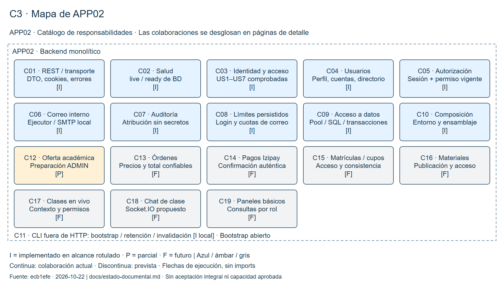
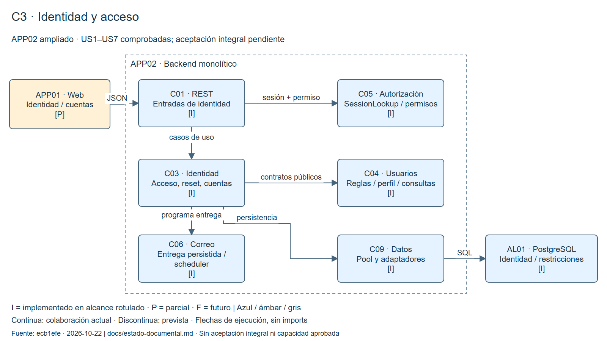
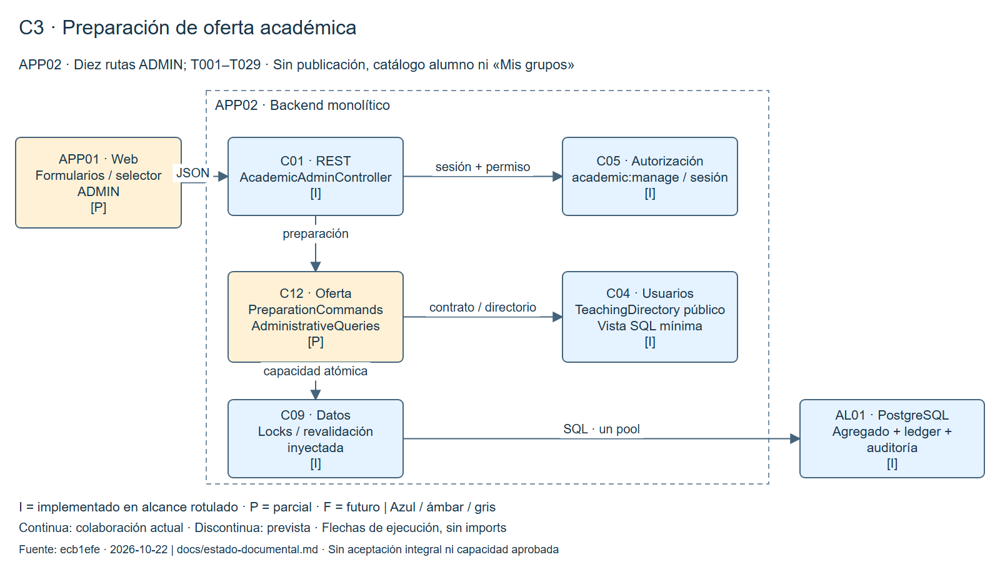

# C3 · Componentes de APP02

Amplía APP02 de [C2](02-contenedores.md); conserva C01–C19 del
[catálogo](../02-arquitectura-software/componentes-arquitectonicos.md).
Cada vista indica alcance; las relaciones son colaboraciones de ejecución o composición
rotulada, no imports. [Estado/evidencia](../estado-documental.md) y
[leyenda](../diagramas/README.md) delimitan I/P/F.

[Editable de ocho páginas](../diagramas/c4-componentes.drawio). Se divide el antiguo
detalle de oferta/adquisición para distinguir preparación actual y compra futura.
Todas las páginas se exportan y revisan, incluidas las complementarias:

- [Composición y salud](../diagramas/imagenes/c4-componentes-composicion.png): C10 ensambla; C02 comprueba BD, sin renovar sesión.
- [Correo y auditoría](../diagramas/imagenes/c4-componentes-correo.png): productor persiste; C06 envía fuera de HTTP; E03 local actual/E02 futuro.
- [Adquisición prevista](../diagramas/imagenes/c4-componentes-adquisicion.png): C13/C14/C15 y E01; no matrículas ni reservas actuales.
- [Acceso académico y chat](../diagramas/imagenes/c4-componentes-acceso.png): C16–C18 y C15, relaciones futuras.
- [Paneles previstos](../diagramas/imagenes/c4-componentes-paneles.png): C19 por capacidades públicas, distinto del inicio mínimo.

La vista de oferta muestra C01 → C12, consumo de C05/C04 y C09 → AL01. El directorio
mínimo y la revalidación se conectan en composición; no hay callbacks identidad → oferta.
Los detalles transaccionales y la diferencia entre contrato público de código y vista
SQL están en [diseño interno](../03-diseno-de-software/diseno-interno/diseno-interno-de-modulos.md).

Identidad tiene checkpoints US1–US7; oferta tiene T001–T029, sin checkpoint T030 ni
publicación/ciclo/lectura alumno-docente. C11 está fuera del proceso HTTP; correo dentro.
Pruebas y fixtures no añaden componentes de producto. Las exportaciones sustituyen
estados antiguos de «ejecutor pendiente» o «sin historias completas».
