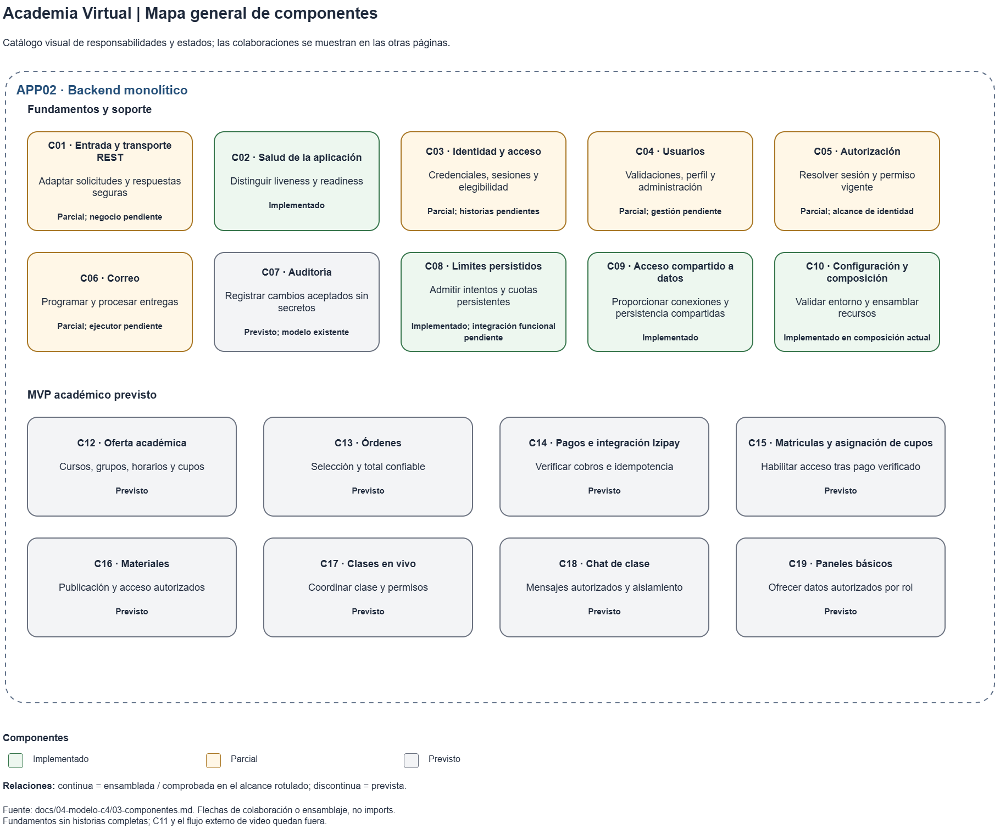
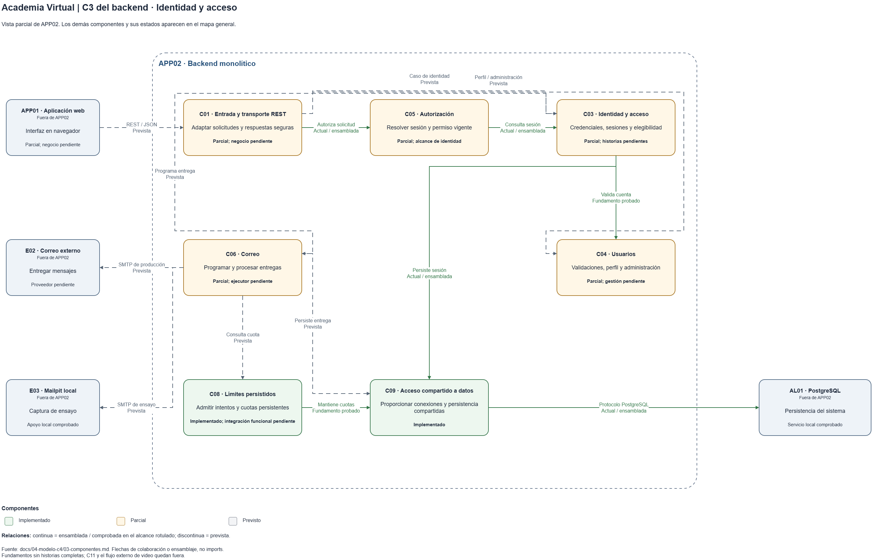

# Componentes C3 del backend

## Alcance

Estas vistas amplían APP02, backend monolítico identificado en el nivel C2. Conservan los identificadores y estados del catálogo de componentes. Las flechas representan colaboración o ensamblaje, no imports; un fundamento comprobado no completa una historia funcional.

## Mapa general

Es un catálogo visual de responsabilidades y estados de C01–C10 y C12–C19. Las relaciones se desarrollan en la vista de identidad y las páginas complementarias del editable.

## C3 de identidad y acceso

Esta vista parcial muestra Entrada REST → Autorización → Identidad, la validación de usuarios y el acceso a PostgreSQL mediante la persistencia compartida.
Incluye límites probados y colaboraciones de correo previstas; los demás componentes están en el mapa general. La web, PostgreSQL y los servicios externos quedan fuera de APP02, con controles actuales diferenciados de flujos pendientes.

## Pendientes

- Identidad completa, auditoría, ejecutor de correo y módulos académicos siguen pendientes. Mailpit acredita captura técnica, no entrega funcional; proveedor de correo e Izipay no están integrados.
- C11 es una entrada operativa fuera del proceso HTTP. No hay worker separado ni conexión de control del backend con YouTube; su reproducción corresponde a la web.
- Acceso al video, recuperación y capacidad de 1000 concurrentes permanecen sin demostrar.

## Referencias

- [Editar las vistas en Draw.io](../diagramas/c4-componentes.drawio): mapa general, identidad y detalles complementarios.
- [Catálogo de componentes](../02-arquitectura-software/componentes-arquitectonicos.md): responsabilidades, relaciones, trazabilidad y fuentes del estado.
