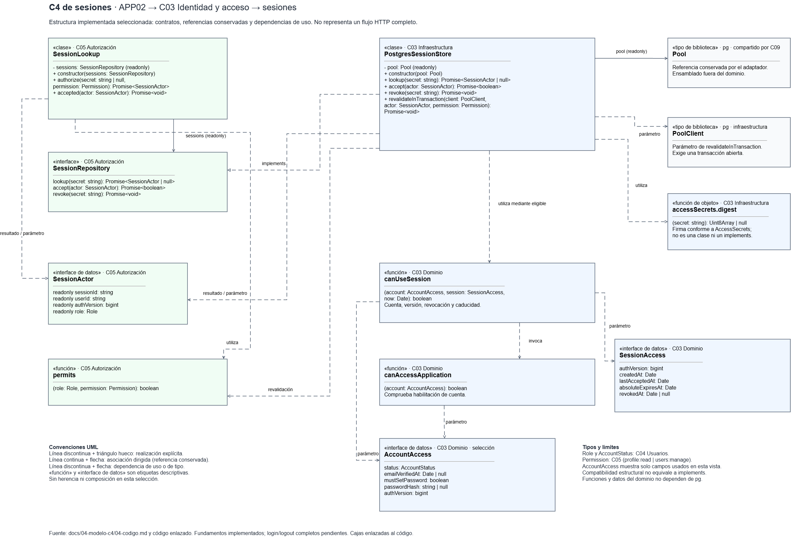

# Código C4: sesiones

## Propósito y alcance

La selección amplía **APP02 → C03 Identidad y acceso → sesiones**, según el catálogo y C3. Describe el adaptador persistido y sus reglas, con colaboradores indispensables de C05 Autorización y C09 Acceso compartido a datos.

## Diagrama C4 de sesiones

[Editar el diagrama en Draw.io](../diagramas/c4-codigo-sesiones.drawio)

Muestra una selección del código de sesiones y sus colaboradores, no todo el sistema ni un flujo completo de inicio y cierre de sesión.

## Elementos principales

| Nombre real | Tipo | Responsabilidad | Código |
| --- | --- | --- | --- |
| `PostgresSessionStore` | Clase · C03 | Implementar consulta, actividad y revocación; `constructor(pool: Pool)` | [session-store.ts](../../apps/api/src/modules/identity/infrastructure/session-store.ts) |
| `SessionRepository` | Interfaz · C05 | `lookup(secret: string): Promise<SessionActor \| null>`; `accept(actor: SessionActor): Promise<boolean>`; `revoke(secret: string): Promise<void>` | [session.ts](../../apps/api/src/modules/authorization/public/session.ts) |
| `SessionLookup` | Clase · C05 | `constructor(sessions: SessionRepository)`; `authorize(secret: string \| null, permission: Permission): Promise<SessionActor>`; `accepted(actor: SessionActor): Promise<void>` | [session-lookup.ts](../../apps/api/src/modules/authorization/application/session-lookup.ts) |
| `AccountAccess` | Interfaz de datos · C03 | Estado, verificación, credencial y versión de cuenta necesarios para elegibilidad | [access.ts](../../apps/api/src/modules/identity/domain/access.ts) |
| `SessionAccess` | Interfaz de datos · C03 | Versión, creación, actividad, caducidad absoluta y revocación | [access.ts](../../apps/api/src/modules/identity/domain/access.ts) |
| `SessionActor` | Interfaz de datos · C05 | Contexto interno: `sessionId`, `userId`, `authVersion`, `role` | [session.ts](../../apps/api/src/modules/authorization/public/session.ts) |
| `canUseSession(account: AccountAccess, session: SessionAccess, now: Date): boolean` | Función · C03 | Evaluar cuenta, versión, revocación y caducidad sin IO | [access.ts](../../apps/api/src/modules/identity/domain/access.ts) |
| `canAccessApplication(account: AccountAccess): boolean` | Función · C03 | Comprobar habilitación de cuenta | [access.ts](../../apps/api/src/modules/identity/domain/access.ts) |
| `accessSecrets.digest(secret: string): Uint8Array \| null` | Función, método de objeto · C03 | Validar el secreto y obtener su huella; firma conforme a `AccessSecrets` | [credentials.ts](../../apps/api/src/modules/identity/infrastructure/credentials.ts) |
| `permits(role: Role, permission: Permission): boolean` | Función · C05 | Evaluar permiso; `Permission` es de C05 y `Role`, de C04 Usuarios | [permissions.ts](../../apps/api/src/modules/authorization/domain/permissions.ts) |

## Relaciones estructurales esenciales

- **Realización:** PostgresSessionStore `implements SessionRepository`; no es herencia de clase.
- **Asociaciones unidireccionales:** SessionLookup conserva `sessions: SessionRepository`; PostgresSessionStore conserva `pool: Pool`. El pool de `pg` se comparte desde C09; las referencias no prueban propiedad exclusiva ni composición UML.
- **Dependencias:** el adaptador usa `accessSecrets.digest`, `canUseSession` y los datos seleccionados. `canUseSession` invoca `canAccessApplication`; SessionLookup depende de `permits` y SessionActor. Las interfaces de datos no son clases persistentes.
- **Operación adicional:** `revalidateInTransaction(client: PoolClient, actor: SessionActor, permission: Permission): Promise<void>` pertenece al adaptador, no al contrato. PoolClient es una dependencia por parámetro, restringida a infraestructura.

El ensamblaje conecta el adaptador con el consumidor. Los imports y firmas justifican dependencias estructurales; las llamadas delegadas describen ejecución. No se atribuye herencia entre las clases seleccionadas.

## Estado y límites

Consulta primaria, revocación idempotente, caducidad, actividad aceptada y revalidación tienen pruebas existentes. La regla pura no renueva sesiones; el adaptador no amplía su caducidad absoluta. Indisponibilidad se comunica con errores tipados, sin conceder acceso.

Son fundamentos comprobados, no el ciclo completo de login/logout ni mutaciones administrativas integradas. La creación de sesiones y revocación conjunta en esos flujos siguen pendientes. El núcleo no importa NestJS ni PostgreSQL; la revalidación transaccional exige una transacción abierta y no traslada PoolClient a aplicación.

## Referencias

- [C3](03-componentes.md), [catálogo](../02-arquitectura-software/componentes-arquitectonicos.md) y [diseño interno](../03-diseno-de-software/diseno-interno/diseno-interno-de-modulos.md).
- [Persistencia compartida](../../apps/api/src/infrastructure/database/database.ts) y [composición](../../apps/api/src/app.module.ts).
- [Pruebas de sesiones](../../apps/api/tests/integration/session-store.spec.ts), [reglas](../../apps/api/src/modules/identity/domain/access.test.ts) y [resultados registrados](../../specs/001-identidad-acceso-roles/evidence/sesiones-autorizacion-http.md).
